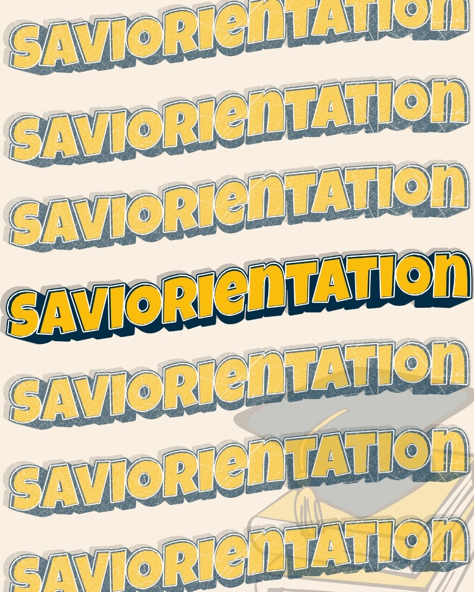
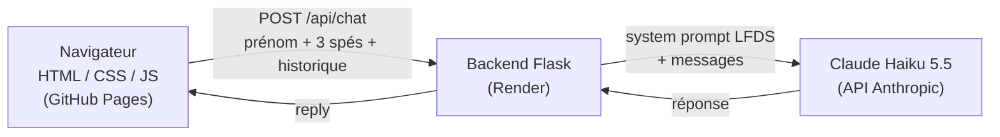

<div align="center">


# Une boussole, pas un juge.

**Assistant d'orientation scolaire pour les élèves de Première du Lycée Français Dominique Savio (Douala, Cameroun).**
Il t'aide à choisir la spécialité à abandonner en Terminale, sans jamais décider à ta place.

[](https://saviorientation.app)
[](https://www.anthropic.com)
[](https://flask.palletsprojects.com)
[](#le-projet)

</div>

---

## L'idée

En Première, on suit **trois spécialités**. En Terminale, il n'en reste que **deux**.
Ce choix pèse sur Parcoursup et sur les études supérieures, et on le fait souvent seul, sous pression, ou en copiant ses amis.

SaviOrientation remplace le formulaire froid par une **vraie conversation** : l'assistant pose des questions ouvertes, apprend à connaître l'élève (centres d'intérêt, difficultés, projet), puis propose une ou deux pistes argumentées en demandant toujours : *« et toi, qu'est-ce que tu en penses ? »*

> La vraie question n'est pas « laquelle je préfère ? », mais « laquelle me rapproche de mon projet ? »

<div align="center">

</div>

## Comment ça marche

1. **Ton profil** : tu indiques ton prénom et tes 3 spécialités actuelles. C'est tout.
2. **La discussion** : l'assistant t'interroge sur tes goûts, tes points forts et tes ambitions.
3. **Tes pistes** : il te propose des pistes justifiées (quelle paire garder, quelles études elle ouvre).

Gratuit, sans inscription. Seul le prénom est demandé et rien n'est enregistré côté serveur : la conversation vit uniquement dans l'onglet du navigateur (`sessionStorage`) et disparaît à sa fermeture, ce qui compte sur les ordinateurs partagés du lycée.

## Ce qu'il est, et ce qu'il n'est pas

| Il est | Il n'est pas |
|---|---|
| Un assistant qui pose des questions et écoute | Un décideur : il n'a aucune autorité sur ton choix |
| Des pistes nuancées, toujours justifiées | Une garantie d'admission dans une formation |
| Un éclairage sur les études liées à chaque spécialité | Un remplaçant des professeurs ou de la PRIO |
| Disponible à toute heure, sans jugement | Un assistant généraliste : il ne parle que d'orientation |

### L'humain avant tout

Si l'élève exprime une forte pression, de l'angoisse ou une détresse, l'assistant **met l'analyse de côté**, répond avec empathie et invite à en parler à la **PRIO** (Professeure Ressource en Information et Orientation) du lycée, à un conseiller d'orientation ou à un adulte de confiance.

## Les 9 spécialités du LFDS

L'assistant ne parle que des spécialités réellement proposées au lycée et des associations prévues par sa grille de formation.

| Code | Spécialité | Famille |
|---|---|---|
| Maths | Mathématiques | Sciences |
| PC | Physique-Chimie | Sciences |
| SVT | Sciences de la Vie et de la Terre | Sciences |
| NSI | Numérique et Sciences Informatiques | Sciences |
| SES | Sciences Économiques et Sociales | Humanités |
| HLP | Humanités, Littérature et Philosophie | Humanités |
| HGGSP | Histoire-Géo, Géopolitique et Sciences Politiques | Humanités |
| LLCE | Langues, Littératures et Cultures Étrangères | Langues |
| AMC | Anglais Monde Contemporain | Langues |

## Architecture



- **Front statique** hébergé sur GitHub Pages : aucune dépendance, aucun framework.
- **Backend Flask** : un seul endpoint `POST /api/chat` et un `GET /health`. La clé API reste **côté serveur** (variable d'environnement), jamais dans le navigateur.
- **Validation stricte** des entrées : prénom borné, exactement 3 spécialités distinctes parmi les 9, historique et longueur des messages limités.
- **CORS restreint** aux origines du site.
- **Garde-fous dans le system prompt** : ne parle que d'orientation, ne révèle pas ses instructions, n'invente aucune règle du lycée, n'est jamais catégorique à 100 %, et ne fonde jamais un conseil sur les seules notes.

### Structure du dépôt

```
SaviOrientation/
├── app.py              # Backend Flask + system prompt
├── requirements.txt    # flask, anthropic, python-dotenv, gunicorn
├── index.html          # Page d'accueil
├── chat.html           # Interface de chat
├── assets/             # style.css, chat.js, logo, favicon
├── images/             # Identité visuelle (logos, visuels, plaquettes)
├── context.txt         # Dossier de contexte complet du projet
└── CNAME               # Domaine personnalisé
```

## Lancer en local

Il faut Python 3.10+ et une clé API Anthropic.

```bash
git clone https://github.com/yohann-evans/SaviOrientation.git
cd SaviOrientation

python -m venv .venv
source .venv/bin/activate        # Windows : .venv\Scripts\activate
pip install -r requirements.txt

echo "ANTHROPIC_API_KEY=ta_cle_ici" > .env    # ignoré par git
python app.py                    # API sur http://localhost:5000
```

Dans un second terminal, sers le site statique :

```bash
python -m http.server 8000       # site sur http://localhost:8000
```

Ouvre ensuite <http://localhost:8000/chat.html>. En local, `chat.js` détecte `localhost` et appelle automatiquement l'API sur le port 5000.

### Variables d'environnement

| Variable | Rôle | Défaut |
|---|---|---|
| `ANTHROPIC_API_KEY` | Clé API Anthropic (**obligatoire**) | : |
| `ALLOWED_ORIGINS` | Origines CORS autorisées, séparées par des virgules | le site officiel |
| `PORT` | Port du serveur en local | `5000` |

## Déploiement

| Partie | Hébergement |
|---|---|
| Site (HTML/CSS/JS) | GitHub Pages, domaine via `CNAME` |
| API (Flask) | [Render](https://render.com), lancé avec `gunicorn app:app` |

Sur Render, ajoute `ANTHROPIC_API_KEY` dans les variables d'environnement du service. Le plan gratuit s'endort après 15 minutes d'inactivité : le site envoie donc un ping `/health` dès l'ouverture de la page pour réveiller le serveur avant le premier message.

## Identité visuelle

<div align="center">


| Bleu marine | Jaune | Crème |
|---|---|---|
| `#092D43` | `#FFC928` | `#F8F0E5` |

Titres en **Bricolage Grotesque**, texte en **DM Sans**.

</div>

Les logos et visuels sont disponibles en PNG et en SVG dans [`images/`](images/).

## Le projet

SaviOrientation est né d'un **projet de Terminale NSI** au LFDS (2025-2026), fait par un élève, pour les élèves. Plutôt que d'entraîner une IA de zéro, il s'appuie sur un modèle de langage existant, encadré par des règles écrites spécialement pour le lycée.

La première version utilisait **Llama 3.3 70B** via l'API Groq. Le projet fonctionne désormais avec **Claude Haiku 5.5** (Anthropic), appelé depuis un backend Python.

| Rôle | Contribution |
|---|---|
| Ingénierie | Élève de Terminale NSI : architecture technique et code |
| Réalité du terrain | Élèves de Première NSI : tests, vrais dilemmes, retours |
| Expertise pédagogique | PRIO du lycée : validation et réalités de l'orientation |

La valeur du projet est là : **un assistant qui connaît le lycée avant de prétendre connaître l'élève.**

---

<div align="center">

*Projet scolaire. Les recommandations sont des pistes de réflexion et ne remplacent pas l'avis de l'équipe pédagogique.*

Fait avec soin par [@yohann-evans](https://github.com/yohann-evans)

</div>
